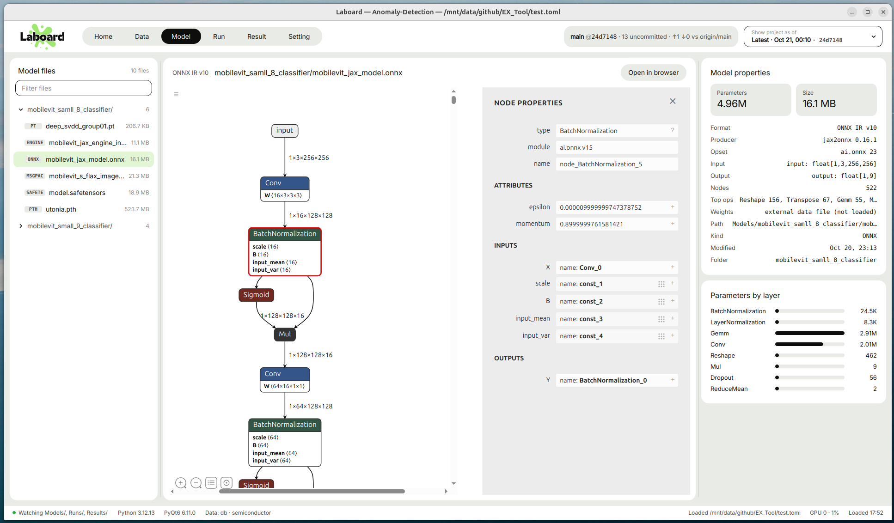

# Model

  

**English** | [한국어](../ko/model.md)

The Model page shows a model file's graph in [Netron](https://netron.app), next to its parameter counts
and file properties. Laboard reads all of this from the file itself, so no GPU and no PyTorch are needed.

## Which files are listed

Every file under `[Path] Models` with a known checkpoint extension is listed:

| Format | Extensions |
| --- | --- |
| PyTorch | `.pt` `.pth` `.ckpt` `.bin` |
| ONNX | `.onnx` |
| safetensors | `.safetensors` |
| JAX / Flax | `.msgpack` |
| TensorRT | `.engine` `.trt` `.plan` |
| Keras | `.h5` `.keras` |
| TensorFlow | `.pb` |
| TFLite | `.tflite` |
| GGUF | `.gguf` |
| Pickle | `.pkl` `.joblib` |
| CoreML | `.mlmodel` |
| OpenVINO | `.xml` |

- To list only some extensions, add `[Models] Extensions = [".pt", ".onnx"]` to the project file.
- If no file matches, every file in the folder is listed instead.
- With one folder per task (`Models/<task>/<model>/`), each `<task>/<model>` counts as one model.
- `[Path] Models` can be on a server, e.g. `"ssh:~/project/Models"`. Files under 500 MB are copied at every load
  ([Files on a remote server](setting.md#files-on-a-remote-server)).

## Left sidebar

**Model files** is a folder tree. Each row shows the extension, the file name and the file size.

## Graph (centre)

The header shows the format and the file name. What the graph shows depends on the kind of file:

| File | What you see |
| --- | --- |
| ONNX, TorchScript and other formats Netron reads | The full graph |
| safetensors, msgpack (weights only) | A list of modules. These files store no wiring between layers |
| `torch.save` checkpoint (`.pt .pth .ckpt .bin`) | A **Layer sequence / As stored** switch (see below) |
| TensorRT engine | A note only. An engine is compiled for one TensorRT version and GPU, so its layers can't be read. Open the ONNX file it was built from instead |

### `torch.save` checkpoints

These files hold weights but not how the layers connect, so Laboard offers two views:

- **Layer sequence** (default): Laboard works out the type of each module from its tensors (Conv /
  Linear / BatchNorm / Norm / Embedding). It chains the modules in the order they were registered and
  shows the result as a shape-only ONNX graph. Branches and skip connections are not shown.
- **As stored**: Netron opens the file exactly as saved.

### Other controls

- **Open in browser** opens the same Netron view in your web browser.
- If `netron` or `PyQt6-WebEngine` isn't installed, the page asks you to run
  `pip install -r requirements.txt`.

## Right panel

### Model properties

- **Tiles:** **Parameters** (the total, when the file has tensors) and **Size**.
- **Rows read from the file.** Which rows appear depends on the format:

| Format | Rows |
| --- | --- |
| ONNX | IR version, producer, opset |
| safetensors / msgpack / PyTorch | Format details and the number of tensors |
| TensorRT | Engine or plan header |

- **Rows from the file system**, always shown:
  - **Path:** relative to the parent of `[Path] Models`.
  - **Kind:** the format.
  - **Modified:** when the file last changed.
  - **Folder:** the folder under `[Path] Models`.

### Parameters by layer

One bar per layer, showing its parameter count. Bar lengths are relative to the largest layer. Long
layer names are shortened in the middle; hover over a name to see all of it.
