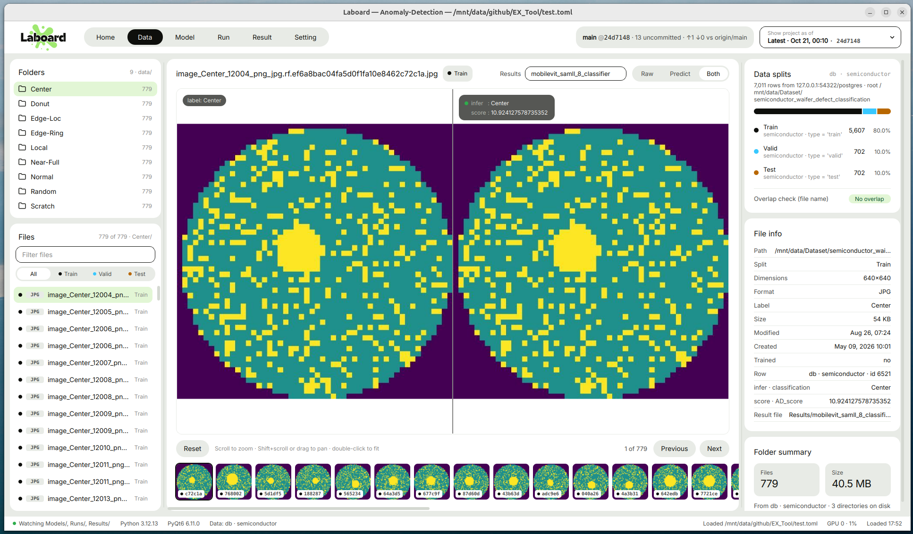

  

# Data

[English](../en/data.md) | **한국어**

Data 페이지는 데이터셋의 모든 파일을 보는 뷰어입니다. 파일마다 다음을 볼 수 있습니다.

- 파일 자체
- split (train / valid / test)
- 레이블
- 모델이 그 파일에 대해 예측한 값

## 데이터 출처

아래 출처 중 처음으로 동작하는 것을 사용합니다.

1. **데이터베이스 테이블:** `[db]`. 로컬 Supabase나 일반 Postgres 모두 됩니다. 접속할 수 없으면 상태
   바에 알리고 다음 출처로 넘어갑니다.
2. **테이블 파일:** `paths.data` 아래의 csv / tsv / jsonl / parquet, 또는 `[data] table`로 지정한 파일.
   경로 열이 실제로 존재하는 파일을 가리켜야 합니다.
3. **폴더 스캔:** `paths.data` 아래의 모든 파일. 코드, 노트북, 마크다운, 테이블 파일은 제외합니다.
   split과 레이블은 `train/<label>/x.jpg` 같은 ImageFolder 형식 경로에서 가져옵니다.

최대 200,000개 행 또는 파일까지 읽습니다.

**열 찾기.** 테이블과 데이터베이스에서는 흔히 쓰는 이름으로 열을 찾습니다. `columns = {…}`로 어떤 열이든
직접 지정할 수 있습니다.

| 의미 | 인식하는 이름 (먼저 일치하는 것 사용) |
| --- | --- |
| path (경로) | `file_path`, `data_path`, `path`, `filepath`, `file`, `image`, `image_path`, `img`, `filename` |
| label (레이블) | `class`, `labels`, `label`, `cls`, `class_name`, `category`, `target` |
| split | `type`, `status`, `split`, `subset`, `set` |
| task (작업 종류) | `object`, `task` |
| created (생성일) | `create_date`, `created_at`, `created`, `date`, `timestamp` |
| trained (학습 사용 여부) | `trained`, `used` |
| predict (예측) | `predict`, `prediction`, `pred`, `predicted` |
| id | `id` |

**split 값.** 아래처럼 읽습니다 (대소문자 무시). 그 외 값은 **Unused**가 됩니다.

| 데이터의 값 | 읽는 방식 |
| --- | --- |
| `train`, `training` | Train |
| `val`, `valid`, `validation`, `eval`, `dev` | Valid |
| `test`, `testing` | Test |

**폴더 묶기.** 파일은 디렉터리에서 split 부분을 뺀 이름으로 폴더가 묶입니다. 그래서 `train/cat/`과
`valid/cat/`은 둘 다 `cat` 폴더로 보입니다.

## 왼쪽 사이드바

### Folders 카드

데이터 폴더와 각 폴더의 파일 수를 보여 줍니다. 폴더를 클릭하면 그 폴더가 열리고 첫 번째 파일이
선택됩니다. 폴더가 9개를 넘으면 목록이 스크롤됩니다.

### Files 목록

- **All / Train / Valid / Test**로 목록, 뷰어, 썸네일을 한 split으로 좁힙니다.
- 각 행에는 split 색 점, 확장자, 파일 이름, split 이름이 표시됩니다.
- 위쪽 개수는 `120 of 3,400 · cat/`처럼 표시됩니다.

## 뷰어 (가운데)

### 머리글

- 파일 이름과 split.
- **Raw / Predict / Both**로 뷰어에 보일 내용을 고릅니다.
  - **Raw:** 파일과 레이블.
  - **Predict:** 파일과 예측 칩(아래 참고).
  - **Both:** Raw와 Predict를 나란히.
- **Results** 드롭다운. `[labels] result_file`과 일치하는 파일이 여러 개일 때만 나타납니다(예: 모델마다
  `inference.csv`가 하나씩). 레이블과 예측을 어느 결과 파일에서 가져올지 고릅니다.

### 이미지

이미지(png, jpg, jpeg, bmp, gif, webp, tif, tiff)만 그려지고, 다른 형식은 줄무늬 자리 표시로 나옵니다.

| 동작 | 효과 |
| --- | --- |
| 스크롤 | 커서 위치를 중심으로 확대/축소 (맞춤 크기의 최대 40배) |
| Shift+스크롤 또는 드래그 | 이동 |
| 더블클릭 | 이미지를 창에 맞춤 |
| **Reset** | 모든 창을 맞춤 크기·가운데로 |

**Both**에서는 각 창이 확대/축소와 위치를 따로 가집니다. 확대 상태는 다른 파일을 볼 때까지 유지됩니다.

### 이동

- `12 of 3,400`은 폴더 안에서 현재 위치입니다.
- **Previous / Next**는 현재 split 필터 안에서 이동하며, 끝에 닿으면 처음으로 돌아갑니다.
- 썸네일 줄에는 현재 파일 양쪽으로 최대 30개씩 보입니다. 썸네일마다 파일 이름의 마지막 6글자와 split
  점이 붙습니다. 클릭하면 그 파일을 봅니다.

### 예측 색상

**`[labels]` 섹션이 있으면** 레이블과 예측을 선택한 결과 파일에서 가져옵니다. 행은 경로로, 경로가 다르면
파일 이름으로 매칭합니다. `[labels]`에 적은 열마다 칩이 하나씩 생깁니다.

| 칩 | 의미 |
| --- | --- |
| 초록색 | 값이 레이블과 같음 |
| 빨간색 | 값이 다른 클래스 |
| 회색 | 그 외 (점수, 텍스트 등) |
| `—` | 값이 비어 있음 |

결과 파일에 그 파일이 없으면 칩에 `not in <file>`이라고 나옵니다.

**`[labels]`가 없으면** 데이터 자체의 `predict` 열을 사용합니다. 레이블과 같으면 초록색, 다르면
빨간색입니다. 열이 비어 있으면 칩에 `none · predict column is empty`라고 나옵니다.

## 오른쪽 패널

### Data splits

- 출처와 `3,400 rows from <위치> · root <폴더>` 같은 설명.
- split 비율 누적 막대.
- split마다 한 행: 개수, 비율, split을 어떻게 정했는지. 예:
  - `type = 'train'` (split 열에서)
  - `split from folder name` (폴더 스캔에서)
  - `no split column`
- split 행을 클릭하면 그 split만 보입니다(사이드바 버튼과 같은 기능). 다시 클릭하면 모든 split을 봅니다.
- **Overlap check (file name):** *No overlap*, 또는 같은 파일 이름이 여러 split에 있으면 *3 shared*
  같은 경고.

### File info

항상 표시되는 행:

| 행 | 내용 |
| --- | --- |
| Path | 파일 전체 경로 |
| Split | 파일의 split |
| Dimensions | 이미지 너비 × 높이 |
| Format | 확장자 |
| Label | 파일의 레이블 |
| Size | 파일 크기. 디스크에 파일이 없으면 `missing` |
| Modified | 파일 수정 시각 |

출처에 해당 데이터가 있을 때만 나오는 행:

| 행 | 나오는 조건 |
| --- | --- |
| Created | 데이터에 생성일 성격의 열이 있을 때 |
| Trained | 데이터에 `trained`/`used` 열이 있을 때 |
| Row | 데이터베이스에서 읽었을 때. 행의 `id` |

`[labels]`가 있으면 설정한 열이 `key · column` 형태로 나오고, 값을 가져온 **Result file**도 표시됩니다
(그 파일에 행이 없으면 `no row`).

### Folder summary

- 현재 폴더의 **Files**(파일 수)와 **Size**(크기).
- 폴더를 읽은 출처.
- 그 파일들이 디스크에서 몇 개의 디렉터리에 나뉘어 있는지.
