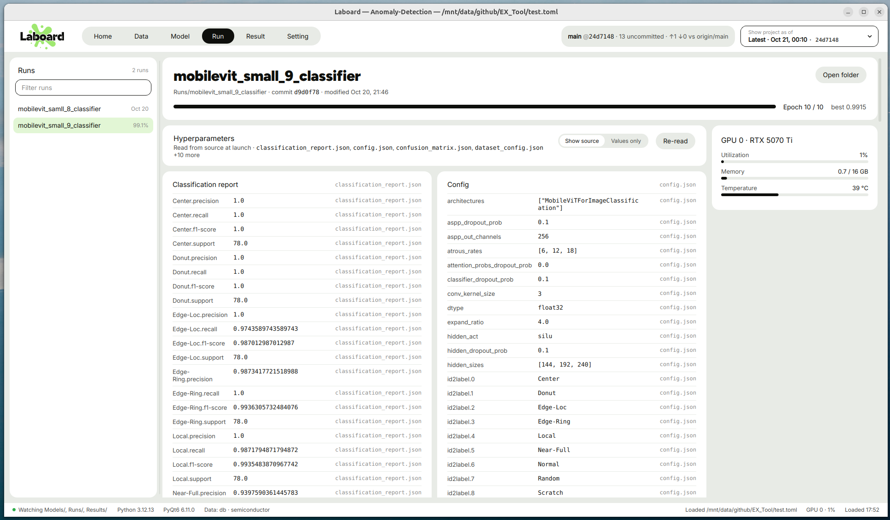

# Hyperparameter

  

[English](../en/hyperparameter.md) | **한국어**

Hyperparameter 페이지는 학습 run 하나의 하이퍼파라미터 세트에 대해 다음을 보여 줍니다.

- run의 위치와 그 폴더를 마지막으로 건드린 커밋
- 학습이 얼마나 진행됐는지
- 설정 파일에 있는 모든 하이퍼파라미터와 각 값이 나온 파일

## 하이퍼파라미터 세트로 인식하는 것

- **세트(학습 run) 조건:** `[Path] Hyperparameter` 아래 3단계 깊이까지의 폴더 중 설정 파일(`.json`, `.yaml`, `.yml`, `.toml`,
  각 2MB 미만)이 들어 있는 폴더.
- **중첩 없음:** 한 폴더가 run으로 인식되면 그 안의 폴더는 따로 run이 되지 않습니다.
- **개수 제한:** 최대 500개까지 읽습니다.
- **YAML:** PyYAML이 설치되어 있어야 읽고, 없으면 건너뜁니다.
- **정렬:** 가장 최근에 수정된 run이 맨 앞에 옵니다.
- **원격:** `[Path] Hyperparameter`는 `"gcloud:~/laboard/Runs"`처럼 서버에 둘 수 있습니다. 불러올 때마다 설정 파일만
  복사합니다([원격 서버의 파일](setting.md#원격-서버의-파일)).
- **이름:** `[Path] Hyperparameter` 기준 상대 경로입니다. `[Path] Hyperparameter` 자체가 run이면 설정의 `exp_name`, `run_name`,
  `name` 중 있는 값을, 없으면 폴더 이름을 씁니다.

## 왼쪽 사이드바

**Hyperparameter**는 폴더 트리입니다(*N sets*). 각 세트 옆에는 다음이 표시됩니다.

- `trainer_state.json`에 0~1 사이의 `best_metric`이 있으면 그 값을 백분율로
- 없으면 마지막 수정 날짜

## 머리글 카드

| 부분 | 내용 |
| --- | --- |
| 제목 | run 이름 |
| 부제 | run 폴더 경로 · 그 폴더를 마지막으로 건드린 커밋 · 마지막 수정 시각 |
| **Open folder** | 파일 관리자에서 run 폴더 열기 |
| 진행 막대 | `trainer_state.json`의 `epoch / 전체 epoch` |
| Epoch 표시 | 예: `Epoch 12 / 50`. `trainer_state.json`이 없으면 `50 epochs configured` 또는 `No trainer_state.json` |
| Best | `trainer_state.json`에 `best_metric`이 있으면 `best 0.9132` |

전체 epoch 수는 아래 중 처음으로 값이 있는 것을 씁니다.

1. `trainer_state.json`의 `num_train_epochs`
2. 설정의 `epochs`
3. 설정의 `num_train_epochs`
4. 설정의 `max_epochs`

여기서 설정은 이름에 `config`, `args`, `hparams`가 들어간 파일을 말합니다.

## 하이퍼파라미터

### 머리글

- **Read from source at launch** 옆에 읽은 설정 파일이 나옵니다. 처음 4개를 보여 주고 나머지는 `+N more`로 표시합니다.

### 검색

머리글의 **Search hyperparameters** 칸에 입력하면 바로 걸러집니다(대소문자 무시).

- **맞는 행:** 키, 값, 출처(설정 파일)에 입력한 글자가 들어 있는 행. 연두색으로 강조됩니다.
- **섹션 제목이 맞으면** 그 섹션의 행을 모두 보여 줍니다.
- **카드:** 맞는 행이 있는 카드만 펼쳐진 채로 남고, 머리글의 행 수는 `2 of 45 rows`처럼 바뀝니다. 페이지는 걸러진 행 기준입니다.
- **개수와 지우기:** 검색 칸 오른쪽에 `N matches`(맞은 행 수)와 **×**(지우기)가 나옵니다.
- **결과 없음:** `No hyperparameters match “…”.` 카드가 나옵니다.
- 검색어는 Hyperparameter 페이지를 떠나기 전까지 유지됩니다.

### 섹션

설정 파일마다 카드가 하나씩 있습니다(`trainer_state.json`은 진행 상황에만 쓰입니다). 카드는 한 줄에
하나씩, 열 전체 폭으로 놓입니다.

- **펼치기 / 접기:** 머리글(▸ 제목 · 행 수 · 파일 이름)을 누르면 표가 펼쳐지고, 다시 누르면 접힙니다. 처음에는 모두
  접혀 있고, 펼친 상태는 Hyperparameter 페이지를 떠나기 전까지 유지됩니다. 펼치고 접어도 스크롤 위치는 그대로입니다.
- **제목:** 파일 이름을 문장형으로 바꾼 것. 예를 들어 `training_args.json`은 *Training args*가 됩니다.
- **키:** 중첩된 키는 점으로 이어 펼칩니다. 예: `optimizer.lr`.
- **긴 값:** 8개보다 긴 리스트는 `[N items]`로, 90자보다 긴 값은 `…`로 잘라서 보여 줍니다.
- **페이지:** 한 페이지보다 행이 많은 카드는 Setting의 [Items per page](setting.md#items-per-page)에서 고른 수(기본 30)씩
  보여 줍니다. 표 아래 페이지 바는 Result 표와 같습니다(Previous · 페이지 번호 · Next, 페이지 번호 입력과 **Go**).
  페이지를 넘겨도 페이지의 스크롤 위치는 그대로입니다. 카드마다 보던 페이지는 Hyperparameter 페이지를
  떠나기 전까지 유지되고, 파일마다 최대 2,000개 행까지 읽습니다.
