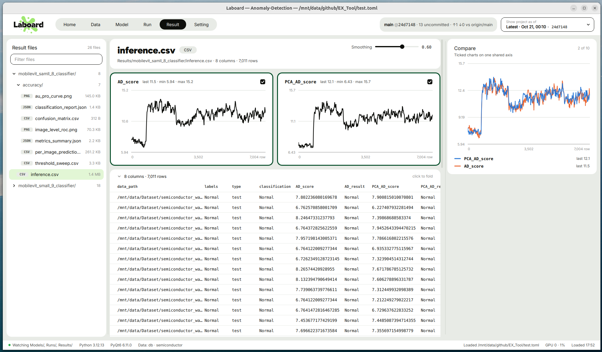

# Result

  

[English](../en/result.md) | **한국어**

Result 페이지는 `[Path] Results` 아래의 모든 파일을 엽니다.

- 지표 파일은 차트와 표로
- 로그와 json은 텍스트로
- 이미지는 확대 가능한 뷰어로

여러 차트를 체크해서 하나의 공통 축에서 비교할 수 있습니다. 결과 파일은 최대 20,000개까지 나옵니다.

`[Path] Results`는 `"gcloud:~/project/Results"`처럼 서버에 둘 수 있습니다. 불러올 때마다 50 MB 미만 파일을 복사합니다
([원격 서버의 파일](setting.md#원격-서버의-파일)).

## 왼쪽 사이드바

**Result files**는 폴더 트리입니다. 각 행에 형식 태그(TensorBoard 이벤트 파일은 `TB`, 그 외는 확장자),
파일 이름, 크기가 표시됩니다.

## 머리글 카드

- **제목:** 파일 이름과 형식 필.

| 필 | 파일 |
| --- | --- |
| TensorBoard | `*tfevents*` |
| CSV / TSV / JSONL | `.csv`, `.tsv`, `.jsonl` |
| Weights & Biases | 이름에 `wandb`가 들어간 csv / tsv / jsonl |
| Image | `.png`, `.jpg`, `.jpeg`, `.bmp`, `.gif`, `.webp` |
| JSON | `.json` |
| Text | 그 외 |

- **둘째 줄:** 프로젝트 루트 기준 경로와 읽은 내용. 예: `12 columns · 3,000 rows`, `8 scalar tags`,
  `1024×768 PNG`.
- **Smoothing** (0–0.95): 모든 차트와 Compare에 적용되는 지수 이동 평균. 파일에 차트가 있을 때만 나타납니다.
- **Reset** (Smoothing 아래): 이 파일에서 체크한 차트를 모두 해제합니다. Compare 그래프가 비고 오른쪽 패널이 닫힙니다.

## 차트

**차트가 되는 열:**

- **csv / tsv / jsonl:** 행의 절반 이상에서 숫자이고 값이 일정하지 않은 열.
- **TensorBoard:** 값이 두 개 이상인 scalar 태그. 이벤트 파일을 직접 읽으므로 TensorFlow가 필요 없습니다.

**x축**은 `step`, `global_step`, `_step`, `epoch`, `iteration`, `iter` 중 처음 있는 열입니다. 하나도
없으면 행 번호를 씁니다. TensorBoard는 step을 씁니다.

**배치:** 파일당 최대 60개 차트를 한 줄에 세 개씩(페이지가 좁으면 더 적게) 보여 줍니다. 긴 시리즈는
약 400개 점으로 줄여서 그립니다. 카드마다 시리즈 이름과 `last · min · max`가 표시됩니다.

| 동작 | 효과 |
| --- | --- |
| 마우스 올리기 | 가장 가까운 점에 세로선이 붙고, 툴팁에 x값과 값이 나옴 |
| Ctrl+스크롤 | 커서 위치를 중심으로 x축 확대/축소 (전체 범위의 1/50까지) |
| 드래그 (확대 상태) | 보이는 구간을 좌우로 이동 |
| 카드 아래쪽 가장자리 드래그 | 차트 높이 변경 (80–1000px) |
| 카드 왼쪽/오른쪽 가장자리 드래그 | 카드 너비 변경 |
| 카드 클릭 | Compare용으로 체크 |

그냥 스크롤하면 페이지가 스크롤됩니다.

## Compare (오른쪽 패널)

1. 차트 카드를 클릭해 체크합니다. 체크한 카드에는 테두리와 체크 표시가 생깁니다.
2. 오른쪽에 **Compare** 패널이 열리고, 체크한 시리즈를 하나의 공통 x축·y축에 그립니다.
   - 한 Compare 그래프에는 10개까지 들어갑니다. 11번째부터는 **Compare 2**, 21번째부터는 **Compare 3**처럼
     새 그래프가 아래에 생기고, 파일당 최대 60개(그래프 6개)까지 체크할 수 있습니다.
   - 그래프마다 체크 테두리 색이 다르고, Compare 제목 옆 점도 같은 색입니다.

     | Compare | 차트 | 테두리 색 |
     | --- | --- | --- |
     | Compare | 1–10번째 | Positive Deep `#054d28` |
     | Compare 2 | 11–20번째 | Positive `#2ead4b` |
     | Compare 3 | 21–30번째 | Warning `#ffd11a` |
     | Compare 4 | 31–40번째 | Warning Deep `#b86700` |
     | Compare 5 | 41–50번째 | Warning Content `#4a3b1c` |
     | Compare 6 | 51–60번째 | Negative Darkest `#a7000d` |

   - 앞 그래프의 체크를 해제하면, 다음에 체크하는 차트가 그 빈자리를 먼저 채웁니다. 그래프에 남은 차트가 없으면
     그 Compare 카드는 사라집니다.
3. 시리즈마다 고유한 색과 점선 패턴이 있고, 범례에 마지막 값과 함께 나옵니다. 다른 차트를 체크하거나
   해제해도 각 시리즈의 색은 그대로입니다.
4. **드래그 앤 드롭:** 왼쪽 차트 카드를 끌어 오른쪽 Compare 카드 위에 놓으면 그 Compare 그래프에 합쳐집니다.
   - 끄는 동안 카드의 반투명 이미지가 커서를 따라오고, 원래 카드는 흐려집니다. 놓을 수 있는 Compare 카드는 그 색으로
     테두리가 켜집니다.
   - 체크하지 않은 차트는 그 그래프에 새로 들어가고, 다른 Compare에 있던 차트는 그 그래프로 옮겨집니다. 그 그래프에
     이미 10개가 있으면 상태 바에 알리고 바꾸지 않습니다.
   - 카드 가장자리를 끌면 지금처럼 크기가 바뀌고, 확대한 차트 안에서 끌면 차트가 이동합니다. Compare 카드는 무언가를
     체크해서 패널이 열려 있을 때만 놓을 수 있습니다.
5. Smoothing도 여기에 적용됩니다.
6. 패널 아래쪽 가장자리를 드래그하면 차트가 높아집니다.
7. 체크한 차트가 하나도 없으면 패널이 닫힙니다.

## 표

csv / tsv / jsonl 파일은 모든 열을 담은 표로도 보여 줍니다.

- **읽는 행 수:** 최대 20,000개. 행 수 뒤의 `+`는 파일에 행이 더 있다는 뜻입니다.
- **페이지:** 한 페이지에 30행씩(Setting의 [Items per page](setting.md#items-per-page)에서 20 / 30 / 40 / 50 / 100 중 선택).
  표 아래 페이지 바: 왼쪽에 `N rows per page · change in Setting`, 가운데에 **Previous**, 페이지 번호
  (처음·마지막·현재와 그 앞뒤, 사이가 비면 `…`), **Next**, 오른쪽에 페이지 번호 입력란과 **Go**(Enter도 됨).
  범위를 넘는 번호는 처음이나 마지막 페이지로 갑니다.
- **열 너비:** 내용에 맞춰 정해지고, 표가 넓으면 가로로 스크롤됩니다.
- **접기:** 큰 표(열 5개 이상이면서 행 10개 이상)는 접힌 상태로 시작합니다. 처음 6행 × 5열만 담은
  차트 크기의 카드로 보입니다. 클릭하면 전체 너비로 펼쳐지고, 다시 클릭하면 접힙니다.

### 정렬, 필터, 열 숨기기

펼친 표에서 열 머리글을 누르면 그 열의 메뉴가 열립니다.

- **Sort ascending / Sort descending:** 그 열로 정렬합니다. 값이 모두 숫자인 열은 숫자 크기로, 아니면 글자 순서(대소문자 무시)로
  정렬하고, 빈 값은 항상 맨 뒤에 둡니다. 이미 고른 정렬을 다시 누르면 정렬을 해제합니다. 한 번에 한 열로만 정렬합니다.
- **Filter:** 입력하는 대로 걸러집니다(Enter로 메뉴 닫기).
  - 글자: 그 글자가 들어 있는 값만 남깁니다(대소문자 무시). 예: `abnormal`
  - 숫자 비교: `> 0.5`, `>= 10`, `< 3`, `<= 1e-3`, `= 2`, `!= 0`. 숫자가 아닌 값은 빠집니다.
  - 여러 열에 건 필터는 모두 만족하는 행만 남깁니다. 지우려면 입력 칸을 비웁니다.
- **Hide column:** 그 열을 숨깁니다. 마지막 남은 열은 숨길 수 없습니다.

머리글에는 정렬한 열에 `↑` / `↓`, 필터를 건 열에 `•`가 붙습니다. 표 위 막대에는 `6 of 8 columns · 877 of 7,011 rows`처럼
보이는 열과 행 수가 나오고, 오른쪽에 두 버튼이 있습니다.

- **Columns:** 모든 열을 체크 목록으로 보여 줍니다. 눌러서 열을 숨기거나 다시 보이게 하고, **Show all**로 모두 보이게 합니다.
- **Reset:** 정렬, 필터, 숨긴 열을 모두 처음으로 되돌립니다(바꾼 것이 있을 때만 보임).

정렬·필터·숨김은 파일마다 따로 유지되고, Result 페이지를 떠나면 초기화됩니다. 바꾸면 첫 페이지로 돌아갑니다.

## 텍스트와 JSON

- 최대 256KB까지 읽습니다.
- 줄마다 번호가 붙습니다.
- `WARN`이 들어간 줄은 주황색, `ERROR`나 `Traceback`이 들어간 줄은 빨간색입니다.
- 텍스트를 선택해서 복사할 수 있습니다.

## 이미지

Data 페이지와 같은 뷰어로 열립니다.

| 동작 | 효과 |
| --- | --- |
| 스크롤 | 커서 위치를 중심으로 확대/축소 |
| Shift+스크롤 또는 드래그 | 이동 |
| 더블클릭 | 이미지를 창에 맞춤 |
